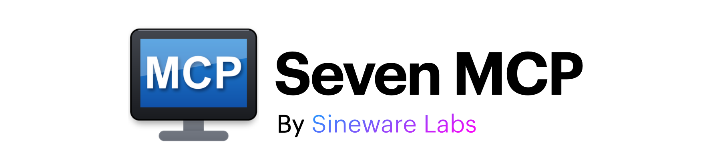
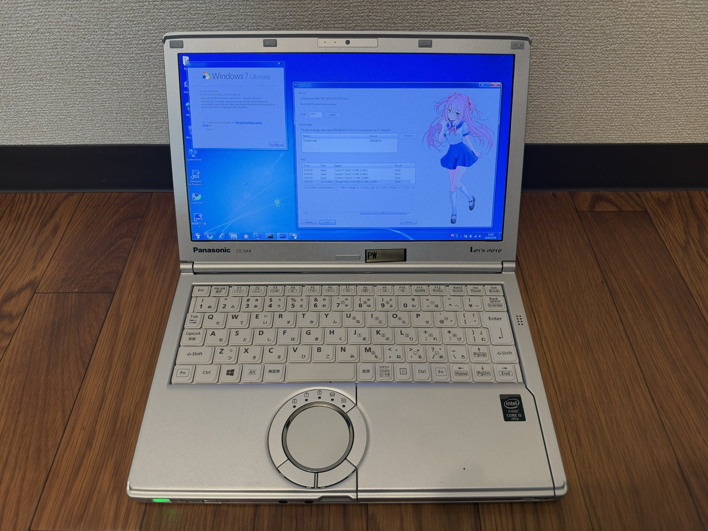
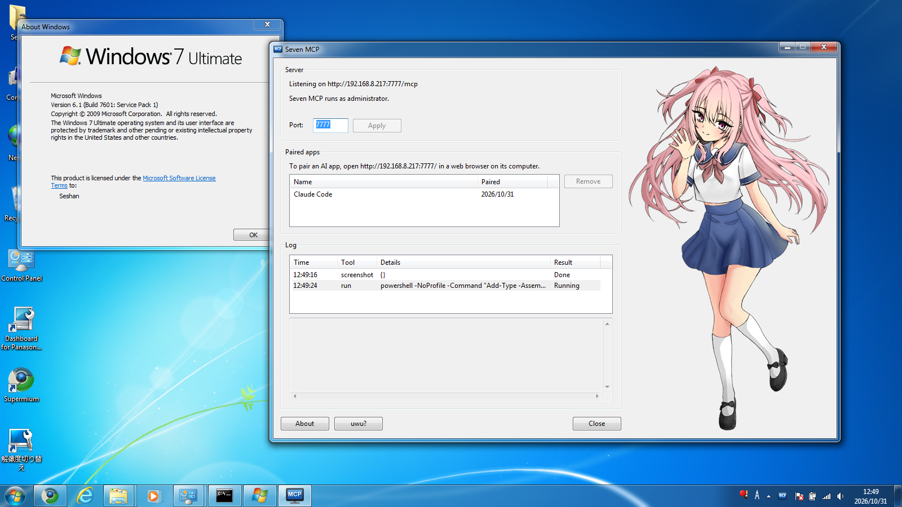

A tray applet program written in Rust (via [rust9x](https://github.com/rust9x)) using the Rust MCP SDK ([rmcp](https://github.com/modelcontextprotocol/rust-sdk)) that lets an MCP-compatible app on your modern computer (Claude Code,
Codex, opencode, and others) control a Windows 7 PC on your network, using the Model Context Protocol. **Make your Windows 7 machine do anything!**

> Obviously, this software is for fun and entertainment. Please don't take it too seriously, and definitely don't use legacy operating systems in production!

<p>
  
  
</p>

*Seven MCP on a Panasonic Let's note CF-SX4 (bought in Akihabara!) with sineware-chan in the window. On the right, a
screenshot of the same screen.*

---

Modern LLM's are surprisingly competent with older systems and their scripting languages(Command Prompt/PowerShell 2.0/VBScript). For example, the Panasonic laptop's (seen above) drivers and utilties were agentcially installed by Claude (which is nice, because there are over 30 individual EXEs from the Panasonic website!).

> In short, Seven MCP let's a modern agentic harness remotely run commands, take screenshots, and click around on a Windows Vista/7 machine. It can help automate menial configuration tasks, or enable you to build bespoke tools and software for your retro computing needs on Windows 7 via Claude Code or other agent harnesses.

## Compatibility
The main support target is **Windows 7 x86/x64**.

Windows Vista is supported on a best-effort basis. 

Anything newer (Windows 8+) also theoretically works, but is otherwise unsupported and untested. Anything older (Windows XP/2000, 9x, etc) is not supported at all.

## MCP Tools
Seven MCP uses the official [MCP Rust SDK](https://github.com/modelcontextprotocol/rust-sdk) (`rmcp`) on tokio and axum, built for Windows 7 with rust9x. It supports the latest stateless MCP standard (2026-07-28) with Streamable HTTP, structured output, etc. Pairing is handled with a PIN over a web flow, which gives you a token to register the MCP server.

- Tools:
  - `run` runs a cmd.exe command (and by extension, PowerShell and VBScript). A long command continues as a job.
  - `job` waits for a job from `run` or `fetch`, polls it, or kills it.
  - `screenshot` captures the screen.
  - `input` uses the mouse and keyboard.
  - `notify` shows a balloon notification.
  - `dialog` shows a dialog box with up to 3 buttons, and a text box if needed, and waits for the user's answer. It lets
    an agent that runs in the background ask the person at the PC. If nobody answers soon, it continues as a job.
  - `fetch` downloads over its own TLS, so it can open modern HTTPS sites that Windows 7 can't. A long download continues as a job.
  - `info` gives the Windows version, the devices that have problems, and platform hints.

## Installation

1. Run `SevenMCP-x64.exe` (or `SevenMCP-x86.exe` on 32-bit Windows). Allow it through Windows Firewall when asked.
2. On your other computer, open `http://<the PC's IP>:7777/` in a browser.
3. Enter the pairing PIN that Seven MCP shows in the balloon notification.
4. The page gives you a token and the setup command for your AI app. For Claude Code:

   ```
   claude mcp add --transport http seven http://<ip>:7777/mcp --header "Authorization: Bearer <token>"
   ```

> The token hash and other setting are saved in the registry under `HKEY_CURRENT_USER\Software\Seven MCP`. 

## Building

Building is simple using Docker to cross-compile for Windows from Linux (or Docker Desktop/OrbStack on Mac or Windows). You can use the provided Dockerfile to build the binaries:

```
docker build -o out .
```

This produces `out/SevenMCP-x64.exe` and `out/SevenMCP-x86.exe`.  The build uses the
[rust9x](https://github.com/rust9x/rust) toolchain on Fedora. It downloads the MSVC CRT and
Windows SDK libraries from Microsoft with [xwin](https://github.com/Jake-Shadle/xwin).

## License

GNU General Public License, version 3 or later (GPL-3.0-or-later). See [LICENSE](LICENSE).
